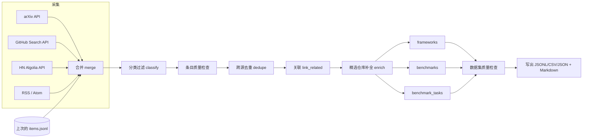

# Benchmark 数据自动化构建方法

本文说明本仓库如何**每天自动地**把 arXiv / GitHub / Hacker News / 博客上与
**RSI（Recursive Self-Improvement，递归自我改进）** 和 **AutoResearch（AI 自动科研）**
相关的原始信息，构建成可直接使用的结构化数据集：

| 产出 | 文件 | 说明 |
| --- | --- | --- |
| 原始条目库 | `data/items.jsonl` | 所有相关论文 / 仓库 / 讨论 / 博文（去重、分类、打标签后） |
| 技术框架清单 | `data/frameworks.json` / `.csv` | 人工精选 + 自动发现的候选框架 |
| Benchmark 目录 | `data/benchmarks.jsonl` / `.csv` | 人工精选 + 自动发现的候选 benchmark |
| 复现任务候选集 | `data/benchmark_tasks.jsonl` | PaperBench 风格的「论文复现」任务候选 |
| 运行统计 | `data/stats.json` | 计数、数据源健康状况、质量检查结果 |
| 可读报告 | `reports/*.md` | 日报、框架清单、Benchmark 清单 |

## 1. 流水线总览

对应代码：`tracker/pipeline.py::run`，各阶段的实现分别在 `tracker/sources/*`、
`classify.py`、`store.py`、`quality.py`、`datasets.py`、`reports.py`。

## 2. 数据来源

全部使用公开、免 API key 的接口（GitHub 使用 Actions 自带的 `GITHUB_TOKEN` 以提高限额）：

| 数据源 | 接口 | 查询方式 | 限速 / 节流 |
| --- | --- | --- | --- |
| arXiv | `export.arxiv.org/api/query` | 每个关键词查询取按提交时间排序的最新 N 篇，限定 cs.AI/LG/CL/MA/NE/SE | 请求间隔 3.5 s |
| GitHub | `api.github.com/search/repositories` | 名称/描述/topic 搜索，默认 `stars:>=10` | 带 token 2.5 s / 无 token ≥7 s |
| Hacker News | `hn.algolia.com/api/v1/search` | 近 30 天、points ≥ 5 的 story | — |
| 博客 | RSS 2.0 / RDF / Atom | Import AI、Interconnects、DeepMind、OpenAI、Sakana、METR 等 12 个 feed，近 60 天 | — |

HTTP 客户端（`tracker/http.py`）对 429 / 5xx / 网络错误做指数退避重试，并识别
GitHub 限流响应头。单个数据源失败只记录到 `stats.json → sources`，**全部失败时才让运行失败**。

## 3. 筛选规则（相关性判定）

规则全部在 `config/sources.yaml` 中，修改配置即可，无需改代码。

1. **文本归一化**：小写、去重音（Gödel → godel）、`-`/`_`/`/` 视为空格。
2. **关键词语法**：默认整词 / 整短语匹配；`foo*` 前缀匹配；`re:` 开头为正则。
3. **主题打分**：对每个主题（`rsi`、`autoresearch`）统计命中的关键词数；
   标题命中额外 +2；来自该主题查询的“查询提示”+1（仅对 `require_keyword_match: false` 的数据源生效，
   即 arXiv —— 学术检索本身已足够精确）。
4. **准入**：分数 ≥ `min_relevance` 的主题保留；没有任何主题的条目被丢弃。
   GitHub / HN / RSS 设为 `require_keyword_match: true`，即名称、描述或正文必须真正命中关键词。
5. **排除词**：`exclude_keywords` 命中的条目直接丢弃（如加密货币、无关同名缩写）。
6. **标签**：`tags` 中每个标签是一组关键词，命中即打标签（`benchmark`、`framework`、
   `paper-replication`、`evolutionary-search` 等）。arXiv 摘要中出现 GitHub 链接的论文额外打 `has-code`。

> 每次运行都会对**全部历史条目重新分类**，所以收紧规则后旧的噪声条目也会被自动清理。

## 4. 去重与合并

| 层级 | 规则 |
| --- | --- |
| ID 归一 | `arxiv:<不带版本号的 id>`、`github:<owner/repo 小写>`、`hn:<objectID>`、`url:<sha1(规范化 URL)[:12]>`（RSS） |
| URL 规范化 | 去掉 `utm_*` 等跟踪参数、fragment、末尾 `/`，host 小写并去掉 `www.`，统一为 `https` |
| 增量合并 | 已存在的 ID：保留 `first_seen`，更新 `last_seen`、指标（star、points 等）、链接，并合并查询主题 |
| 跨源去重 | HN / RSS 之间，规范化 URL 或规范化标题相同即视为重复，保留互动量最高的一条，其余 ID 记入 `extra.duplicate_ids`；之后再采集到这些别名 ID 会被直接跳过 |
| 关联 | HN / 博客链接指向 arXiv 或 GitHub 的，写入目标条目的 `links.discussions`；论文摘要中引用的仓库与仓库条目互相写入 `related_ids` |
| 数据集去重 | 框架按仓库名去重（精选优先）；benchmark 候选按规范化名称去重，并跳过与精选同名 / 同仓库 / 同 arXiv 的条目 |

## 5. 数据集构建规则

### 5.1 技术框架 `frameworks`

* **精选**（`status: curated`）：来自 `config/frameworks.yaml`，人工维护名称、类别、简介、论文。
  每天通过 GitHub `/repos` API 补全 star、fork、语言、许可证、最近提交时间、是否归档 / 已迁移
  （`repo_status`、`repo_moved_to`）。API 不可用时沿用上一版数据。
* **自动候选**（`status: candidate`）：相关的 GitHub 仓库，star ≥ `min_stars`（默认 100），
  不是 benchmark，且不命中 `exclude_keywords`（awesome 列表、教程、面试题等）。
  类别按 `datasets.frameworks.categories` **顺序取第一个命中**，按 star 排序取前 `max_candidates` 个。

### 5.2 Benchmark `benchmarks`

* **精选**：`config/benchmarks.yaml`（MLE-bench、RE-Bench、PaperBench、MLAgentBench、MLGym、
  MLRC-Bench、CORE-Bench、SUPER、ScienceAgentBench、DiscoveryWorld、LAB-Bench、BixBench、
  SciCode、SWE-bench、HCAST、METR Time Horizon），带任务规模和指标说明。
* **自动候选**：带 `benchmark` 标签，且
  * arXiv 论文：标题含 `bench`、`leaderboard`、`arena`、`gym`、`evaluation suite`；
  * 仓库：仓库名含上述词，或描述以「a/an/the … benchmark」开头自我介绍。
* **名称抽取**：优先取标题冒号前的短名（`PaperBench: Evaluating…` → `PaperBench`），
  否则取标题中的 `*Bench*` 词。
* **领域 `focus`**：按 `datasets.benchmarks.focus` 顺序取第一个命中
  （paper-replication → ml-engineering → ai-rnd → research-ideation → scientific-discovery → coding → self-improvement → general-agent）。

### 5.3 复现任务候选 `benchmark_tasks`

参照 PaperBench 的思路，把「相关论文 + 官方代码」自动转成**论文复现任务**：

* 来源：相关 arXiv 论文，摘要中给出了 GitHub 代码仓库，且不是综述；
* `instructions`：仅凭论文复现主要实验结果，官方代码作为评分参考被留出；
* `difficulty_hint`：启发式（涉及预训练 / RL / 大规模 GPU → hard；仅 prompting / 评测 → easy；否则 medium）；
* `grading`：`{"type": "rubric", "rubric": null, "reference": "official-code", "status": "todo"}`，
  评分细则需人工或 LLM 后续补充。

这些任务是**候选**，用于持续扩充自建 benchmark 的题库，进入正式集合前应人工审核。

## 6. Schema

### `data/items.jsonl`（每行一个条目）

| 字段 | 类型 | 说明 |
| --- | --- | --- |
| `id` | str | 见去重规则中的 ID 方案 |
| `source` / `type` | str | `arxiv/paper`、`github/repo`、`hn/discussion`、`rss/article` |
| `title` / `url` / `summary` | str | 标题、规范化链接、摘要或描述 |
| `authors` | list[str] | 作者 / owner / 发布者 |
| `published` / `updated` | ISO-8601 UTC | 发布时间 / 最近更新时间（仓库为最近 push） |
| `first_seen` / `last_seen` | ISO-8601 UTC | 本项目首次 / 最近采集到的时间（增量依据） |
| `topics` | list[str] | `rsi` / `autoresearch` |
| `relevance` | int | 相关性分数 |
| `tags` | list[str] | 细分标签 |
| `metrics` | dict | `stars/forks/open_issues`、`points/comments` 等 |
| `links` | dict | `pdf`、`discussions`、`hn` 等 |
| `related_ids` | list[str] | 关联条目 |
| `extra` | dict | 来源特有字段（arXiv 分类、代码仓库、GitHub topics、`duplicate_ids` 等） |
| `query_topics` | list[str] | 命中的查询所属主题 |

### `data/frameworks.json` / `frameworks.csv`

`id, name, category, topics, status(curated|candidate), source(curated|auto), org, repo, url,
arxiv_id, year, stars, forks, language, license, last_push, repo_status(ok|archived|not_found),
description, first_seen, last_seen, evidence`（可选 `repo_moved_to`）。

### `data/benchmarks.jsonl` / `benchmarks.csv`

`id, name, focus, topics, status, source, org, arxiv_id, paper_url, repo, homepage, year,
tasks, metric, stars, repo_status, description, first_seen, last_seen, evidence`。
`evidence` 为支撑该记录的条目 ID 列表。

### `data/benchmark_tasks.jsonl`

`task_id(replicate:<arxiv_id>), task_type, status, difficulty_hint, topics, tags,
paper{arxiv_id,title,url,published}, code_repos, instructions, grading, source_item, first_seen`。

CSV 中的列表字段用 `; ` 连接。所有输出按稳定顺序排序，便于 git diff 审阅每日变化。

## 7. 质量检查

写出任何文件之前执行（`tracker/quality.py`）：

* **条目级**：必填字段非空；`source` 与 `type`、ID 前缀一致；URL 为 http(s)；
  时间为 ISO-8601 UTC；至少一个主题。不合格条目被丢弃并记录到 `stats.json → quality.dropped_examples`。
* **数据集级**：ID 唯一、名称非空、`status` 合法、精选记录必须有 URL。
  任何一条失败都会让运行以非零退出码结束，**Action 失败且不提交数据**，避免脏数据进入仓库。
* **数据源健康**：每个源记录 `ok / partial / failed / disabled`、抓取条数和错误信息，展示在日报和 Actions Step Summary 中。
* **单元测试**：`tests/` 离线覆盖解析器、关键词匹配、分类、合并去重、数据集构建和端到端流程；workflow 在采集前先跑测试。

## 8. 增量更新

* 每天 01:17 UTC 由 `.github/workflows/collect.yml` 运行，也可手动触发（可选只跑部分数据源）；
* 读取上次的 `items.jsonl` 作为基线，新条目 `first_seen` = 本次时间，日报只列出当天新增；
* 数据集记录保留 `first_seen`，精选仓库的指标每天刷新；
* 有变化才提交（`data: update YYYY-MM-DD [skip ci]`），推送冲突时基于远端最新数据重新构建并重试（不合并生成文件）；
* `python -m tracker build` 可在不联网的情况下用已有条目按新配置重建所有数据集和报告。

## 9. 如何扩展

| 需求 | 做法 |
| --- | --- |
| 新增关键词 / 主题 | 编辑 `config/sources.yaml → topics`，新增主题会自动出现在统计与报告中 |
| 新增查询 | 在对应数据源的 `queries` 中追加（arXiv 支持原始查询语法；GitHub 支持 `in:`、`topic:`、`stars:` 等限定符） |
| 新增博客 | `sources.rss.feeds` 追加 `{name, url}` |
| 新增精选框架 / benchmark | 编辑 `config/frameworks.yaml` / `config/benchmarks.yaml` |
| 新增标签 / 类别 / 领域 | 编辑 `tags`、`datasets.frameworks.categories`、`datasets.benchmarks.focus`（注意按顺序匹配） |
| 降低噪声 | 加入 `exclude_keywords` 或 `datasets.frameworks.exclude_keywords`，然后 `python -m tracker build` 本地查看效果 |
| 新增数据源 | 在 `tracker/sources/` 下实现 `collect(cfg, client, log) -> {"items", "errors"}`，用 `models.make_item` 构造条目，并在 `tracker/sources/__init__.py` 注册 |
| 把候选转为正式 | 将候选记录的信息补全后写入精选 YAML；任务候选补充 `grading.rubric` 后可导出为正式评测集 |
